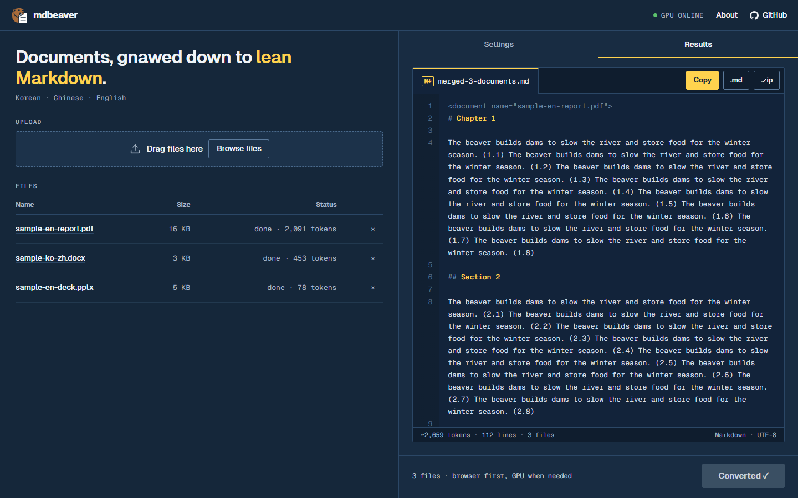
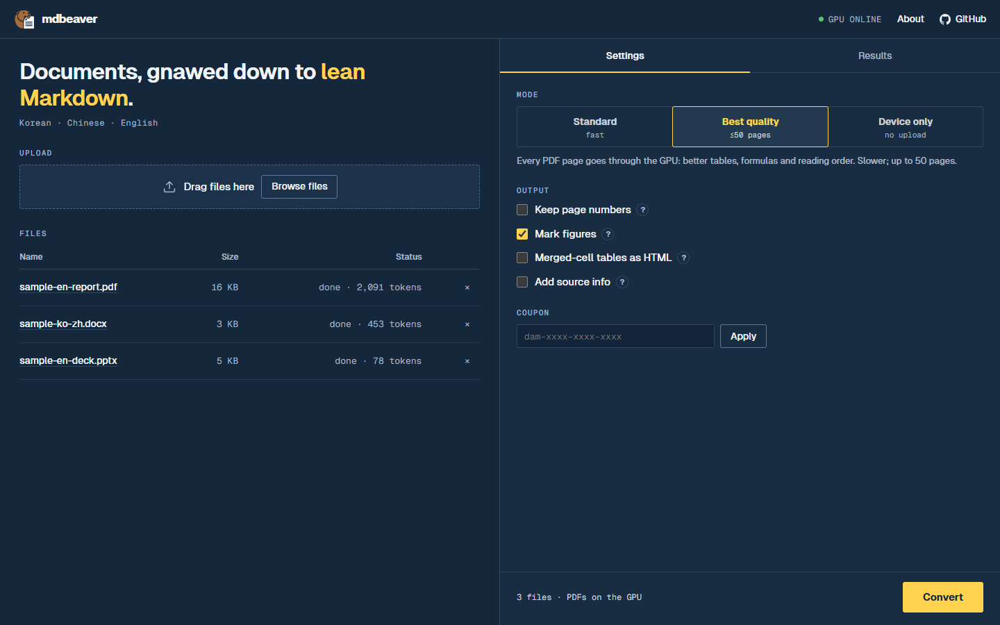
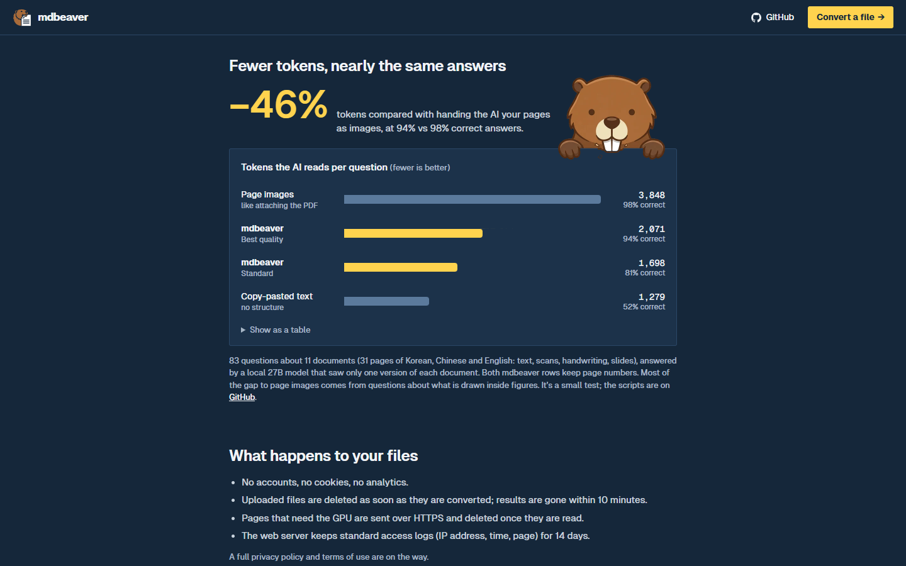
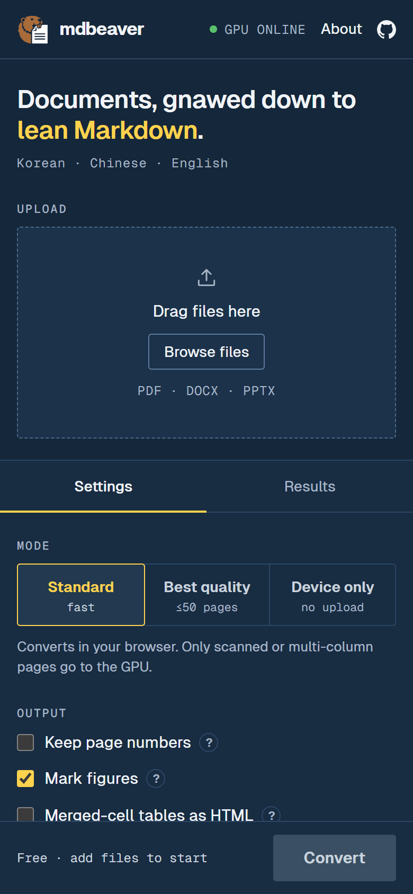
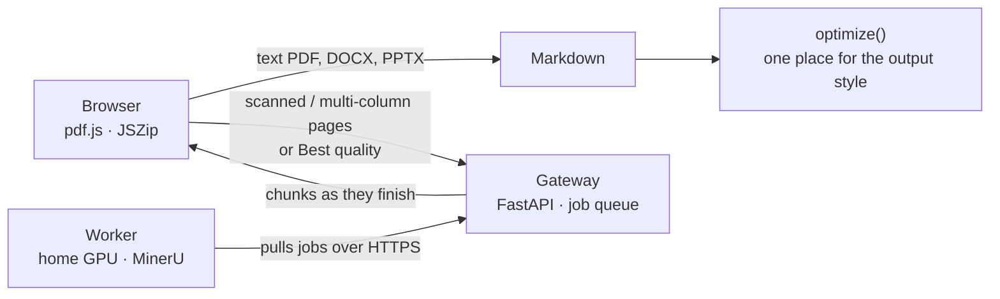

<div align="center">


# mdbeaver

**Documents, gnawed down to lean Markdown.**
Turn PDF, Word, PowerPoint and Hangul (HWP, HWPX) files into Markdown that an AI reads with fewer tokens.

[](https://mdbeaver.com)


[](LICENSE)



</div>

## Why

Handing an AI a PDF usually means handing it page images or a messy text dump. Images cost a lot of tokens; plain text loses tables, headings and reading order. mdbeaver keeps the structure (headings, lists, tables, LaTeX formulas) and strips what an AI does not need (running headers, page numbers, decorative lines, invisible characters).

On our test set an AI answered **94%** of questions correctly from mdbeaver's Markdown, against **98%** from the page images, while reading **46% fewer tokens**. See [Benchmarks](#benchmarks).

## Features

- **Browser first.** Text PDFs, Word, PowerPoint and Hangul (HWP, HWPX) are converted on your own device and never uploaded.
- **GPU only where it helps.** Scanned pages, two-column layouts and big tables go to a GPU running [MinerU](https://github.com/opendatalab/MinerU). *Best quality* sends every page.
- **Built for AI.** Optional page markers (`[p.12]`) so answers can cite pages, figure markers so the AI knows an image was there, merged-cell tables as HTML, and front matter with the source.
- **Several files at once,** merged into one Markdown file with each wrapped in `<document name="…">`, or downloaded separately as a `.zip`.
- **Long documents** (up to 1000 pages with a coupon) run on the GPU in 100-page chunks; each chunk shows up as soon as it is done.
- **Honest about gaps.** Pages that could not be read are listed with their page numbers and the reason.
- **No accounts, no cookies, no tracking.** Uploads are deleted right after conversion; the only count kept is an anonymous daily total.

<table>
  <tr>
    <td width="50%"></td>
    <td width="50%"></td>
  </tr>
  <tr>
    <td align="center">Settings: three modes and the output options</td>
    <td align="center">About: the token chart (the beaver takes a bite)</td>
  </tr>
</table>

<p align="center"></p>

## How it works



1. The browser converts every file first. A PDF page it cannot read (a scan) or can only guess (columns, large tables) is marked for the GPU.
2. Those pages are uploaded to the gateway, which keeps an in-memory queue (small files first) and deletes each file once it is converted.
3. The worker on a home GPU only makes outbound HTTPS requests: it claims a job, converts it with MinerU 100 pages at a time, reports each chunk and sends a heartbeat. If the PC goes off mid-job, the gateway notices within a minute and the browser keeps the pages that were done.
4. Every path ends in the same `optimize()` step (`web/js/output.js`), so the output style is decided in one place.

| Path | What | Runs on |
|---|---|---|
| `web/` | Static site, no framework. PDF (pdf.js), DOCX, PPTX, HWP and HWPX conversion in the browser | Nginx |
| `gateway/` | FastAPI: uploads, job queue, coupons, worker API | Server (systemd, localhost) |
| `worker/` | Pulls jobs, converts with a pluggable engine (`basic` CPU or `mineru` GPU) | Home GPU PC |
| `deploy/` | Nginx config, systemd unit, deploy script, coupon tool | — |
| `bench/` | Token, engine and accuracy benchmarks | Your machine |

## Benchmarks

Everything in `bench/` runs the **same conversion code as the site** (`web/js`, loaded in Node through `bench/node-shim.mjs`). The test documents themselves are not in the repository.

### Accuracy per token (the number that matters)

11 documents, 31 pages of Korean, Chinese and English: text, scans, handwriting, slides, tables and formulas. 83 questions (facts, tables, formulas, figures, page citations), each answered by a local **Qwen3.8-27B** (Q4, LM Studio, temperature 0) that saw **only one version** of the document. Answers are graded by substring match first, then by the same model for the rest.

| What the AI was given | Correct | Without figure questions | Tokens / question |
|---|---:|---:|---:|
| Page images (like attaching the PDF) | **98%** | 97% | 3,848 |
| **mdbeaver, Best quality + page numbers** | **94%** | **96%** | **2,071** |
| mdbeaver, Standard + page numbers | 81% | 86% | 1,698 |
| Copy-pasted text | 52% | 55% | 1,279 |

- Best quality reads **46% fewer tokens** than page images at 4 points lower accuracy; without figure questions the two are level (96% vs 97%).
- Most of the remaining gap is information drawn *inside* figures (axis values, labels), which Markdown can only describe.
- Page questions ("which page?") are only answerable with page numbers on.
- Small test, one answering model: other models will give other numbers. Full write-up: [`bench/results/accuracy-2026-10-29.md`](bench/results/accuracy-2026-10-29.md).

### GPU engines

PaddleOCR-VL 1.6, MinerU 4.0.12 and OvisOCR2 were run on the same 11 documents on an RTX 5090 D (24 GB, WSL2). MinerU was chosen for its output quality on tables, formulas and Chinese scans at about 2.7 s per page. Details: [`bench/results/engines-2026-10-29.md`](bench/results/engines-2026-10-29.md).

### Reproduce

```bash
# A. Tokens (CPU only)
cd bench && npm install && node make-samples.mjs
npm run tokens -- samples          # synthetic samples
npm run tokens                     # your own files in bench/docs/

# B. GPU engines (WSL with the engines installed)
bash bench/engines/run_all.sh mineru

# C. Accuracy: an OpenAI-compatible local server (LM Studio), set MDB_LLM_URL / MDB_LLM_MODEL
node --import ./node-shim.mjs variants.mjs   # the versions the AI gets (GPU ones from bench/out/worker-mineru-*.md)
python accuracy.py --limit 5                 # smoke test, then without --limit
```

Questions live next to the documents (`bench/docs/questions.json`, not committed). Raw results are in `bench/results/`.

## Run your own

<details>
<summary><b>Server (gateway + site)</b></summary>

```bash
cd web && npm install && npm run vendor && cd ..   # vendors pdf.js, JSZip and fonts into web/vendor
MDB_HOST=ubuntu@<server> MDB_SSH_KEY=~/.ssh/<key> bash deploy/deploy.sh
```

The first deploy creates `/etc/mdbeaver/gateway.env` on the server with a fresh worker token; it never leaves the server unless you copy it.
</details>

<details>
<summary><b>Worker (GPU PC)</b></summary>

```bash
cd worker
python -m venv .venv
.venv/Scripts/pip install -r requirements.txt
```

`worker/.env` (git-ignored):

```
MDB_GATEWAY_URL=https://your-domain
MDB_WORKER_TOKEN=<MDB_WORKER_TOKEN from the server>
MDB_ENGINE=mineru        # or basic (CPU, text layer only)
```

Start MinerU in WSL with `wsl -d Ubuntu-24.04 -- bash worker/mineru-server.sh` (models load in 1–3 minutes), then run `.venv/Scripts/python worker.py`. `worker/install-autostart.ps1` registers both as Windows scheduled tasks. The site's status dot turns green while the worker is connected.
</details>

<details>
<summary><b>Coupons</b></summary>

A file normally gets up to 50 GPU pages and 50 MB. A coupon raises that for whoever has it (Settings → Coupon; remembered in their browser). On the server:

```bash
mdb-coupons add --name friends --pages 1000 --upload 200                 # unlimited uses
mdb-coupons add --name launch --uses 1 --count 20 --expires 2026-12-31   # 20 one-time coupons
mdb-coupons list
mdb-coupons remove --name launch
```

One use is one file sent to the GPU, given back if that job fails or is withdrawn.
</details>

## Privacy

- No accounts, cookies or tracking. The page stores only an applied coupon, in your own browser.
- One anonymous tally per day (`gateway/app/stats.py`): files per type, pages, how many used the GPU or failed. No IP address, file name or content goes into it; *Device only* sends nothing. The owner reads it with `mdb-stats`.
- Files that need the GPU are sent over HTTPS, read, and deleted at once; results are dropped within 10 minutes.
- The web server keeps standard access logs (IP address, time, page) for 14 days.
- *Device only* mode uploads nothing at all.

## Credits

GPU conversion by [**MinerU**](https://github.com/opendatalab/MinerU) (Apache 2.0, attribution shown on the site's About page). In-browser conversion with [pdf.js](https://mozilla.github.io/pdf.js/) (Apache 2.0) and [JSZip](https://stuk.github.io/jszip/) (MIT). Set in [Geist](https://vercel.com/font) (OFL 1.1).

## License

mdbeaver's own code is [MIT](LICENSE). The libraries and models it uses keep their own licences (see Credits); the beaver artwork is part of the site and not covered by the MIT grant.

## Support

mdbeaver is free and runs on one home GPU. If it saved you time, a coffee through WeChat keeps the beaver chewing.


